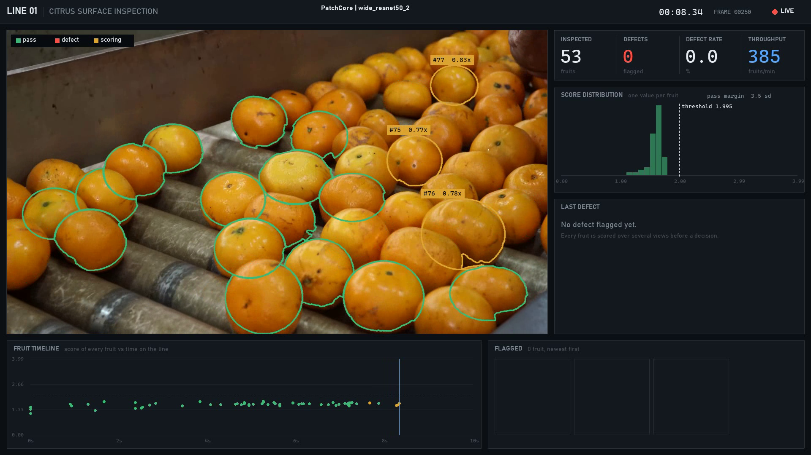
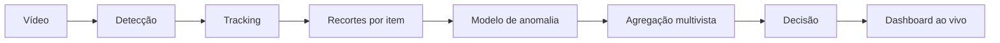

# Citrus Inspection Vision

Pipeline público de inferência e analytics para inspeção visual de frutas em esteira, desenvolvido por Francisco Oliveira.



## O que está neste repositório

- detecção de instâncias em vídeo;
- tracking multiobjeto em duas etapas;
- seleção e análise de múltiplas vistas por fruta;
- integração com modelo privado via TorchScript;
- decisão por item e dashboard operacional em tempo real;
- validação de configuração, fonte de vídeo e contrato do modelo;
- testes automatizados do runtime.

Datasets, pesos, código de treinamento, calibração e hiperparâmetros de treinamento não fazem parte da versão pública.

## Arquitetura



O runtime separa captura, detecção, tracking, scoring e visualização. O modelo recebe lotes de imagens e máscaras e devolve um score e um mapa de anomalia por item. A decisão é consolidada entre diferentes frames para reduzir alarmes causados por reflexo, oclusão ou desfoque pontual.

O histórico em memória é limitado, os totais permanecem acumulados e a captura é sempre liberada ao encerrar. Vídeos locais respeitam o FPS do arquivo; falhas de câmera e saídas incompatíveis do modelo interrompem a execução com uma mensagem objetiva.

## Indicadores

Resultados de validação offline interna:

| Métrica | Resultado |
| --- | ---: |
| Acurácia | 97,4% |
| Recall | 100,0% |
| AUROC | 0,992 |

Os números representam um benchmark controlado e não substituem validação na linha de produção.

## Execução local

Requer Python 3.10 ou superior.

```powershell
python -m venv .venv
.venv\Scripts\Activate.ps1
python -m pip install -e ".[inference]"
citrus-inspect model.pt --source 0
```

O valor `0` abre a câmera principal. Para analisar um vídeo local:

```bash
citrus-inspect model.pt --source video.mp4 --threshold 0.55
```

Pressione `Q` ou `Esc` para encerrar. O projeto não grava nem gera vídeos; para registrar uma execução, use o gravador de tela da própria máquina.

Quando `--threshold` não é informado, o valor de `runtime.threshold` em `configs/inference.yaml` é utilizado. O mesmo arquivo concentra os parâmetros de detecção, tracking, seleção de vistas e retenção do histórico.

Para rodar os testes:

```bash
python -m pip install -e ".[dev]"
pytest
```

O artefato deve receber `images` e `masks` e retornar `scores` e `maps`. O pré-processamento específico do modelo deve estar encapsulado no próprio TorchScript.

## Bases públicas para experimentação

Quem quiser desenvolver um treinamento próprio pode avaliar o [MVTec AD](https://www.mvtec.com/research-teaching/datasets/mvtec-ad), o [VisA](https://github.com/awslabs/open-data-registry/blob/main/datasets/visa.yaml) e o [Roboflow Universe](https://universe.roboflow.com/). São referências públicas independentes e não descrevem a base usada neste projeto.

O frame de demonstração do dashboard utiliza vídeo de Thiago Zanutim Lucas, via [Pexels](https://www.pexels.com/video/10576684/).

